# Hey, I'm Sufiya Inamdar

 

<h3 align="center">Computer Engineering Student | Aspiring AI Engineer | Python & Web Development</h3>

---

## About Me

I'm a Computer Engineering student passionate about Artificial Intelligence, Machine Learning, and software development. I enjoy building practical applications and learning technologies that solve real-world problems.

- Currently learning: Machine Learning, DSA, and Web Development
- Interested in: AI Engineering, NLP, and intelligent systems
- Building: AI-powered recommendation systems and data-driven applications
- Goal: Become a skilled AI Engineer and build impactful products

---

## 🛠️ Tech Stack & Tools

### Languages

### Development & AI

---

## 📊 GitHub Analytics

  
  

  

---

## 📈 Contribution Graph

  

---

## 🤝 Connect With Me

  
  

  <h3>✨ Build • Learn • Create • Grow ✨</h3>
  <i>Small steps every day lead to big results.</i>

